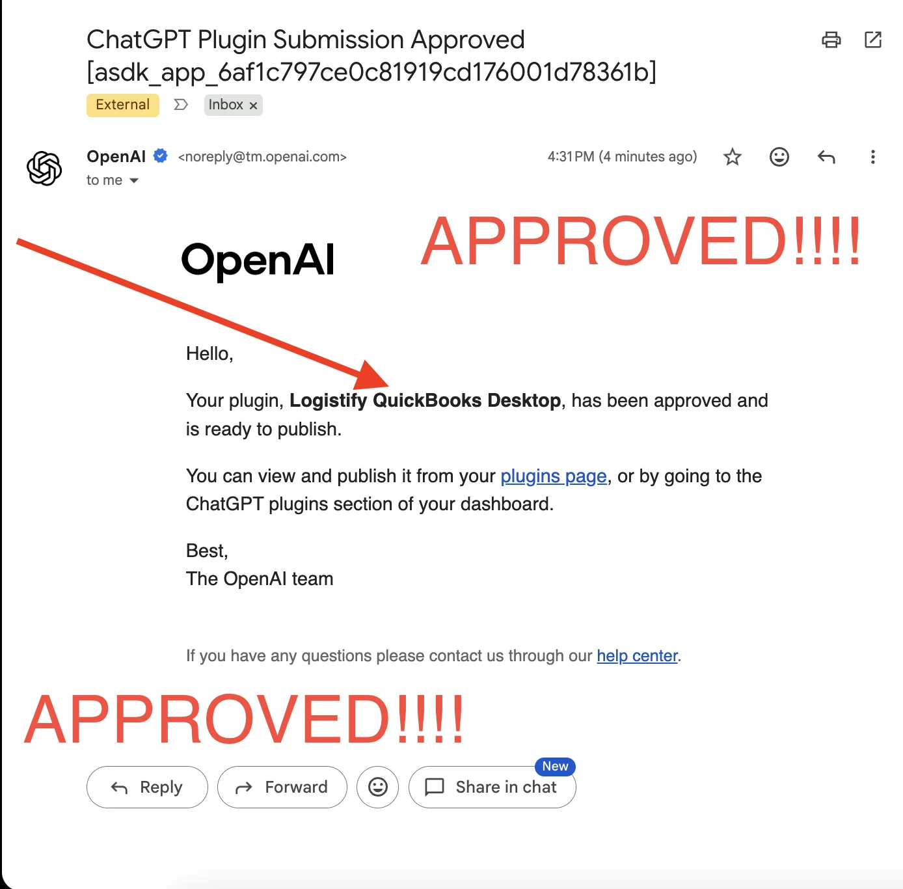
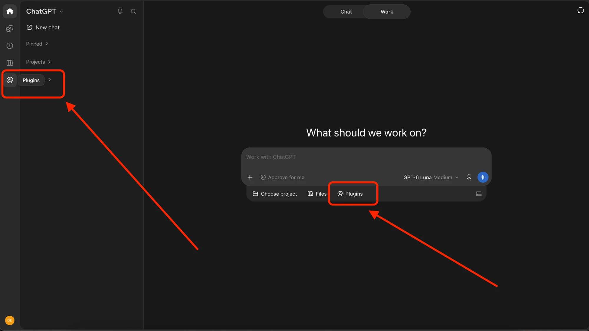
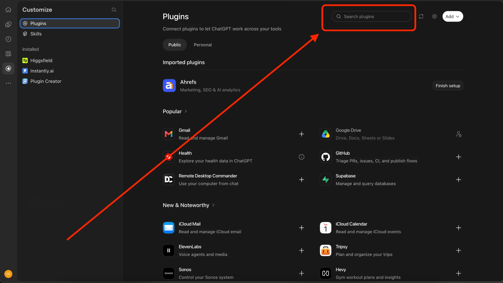
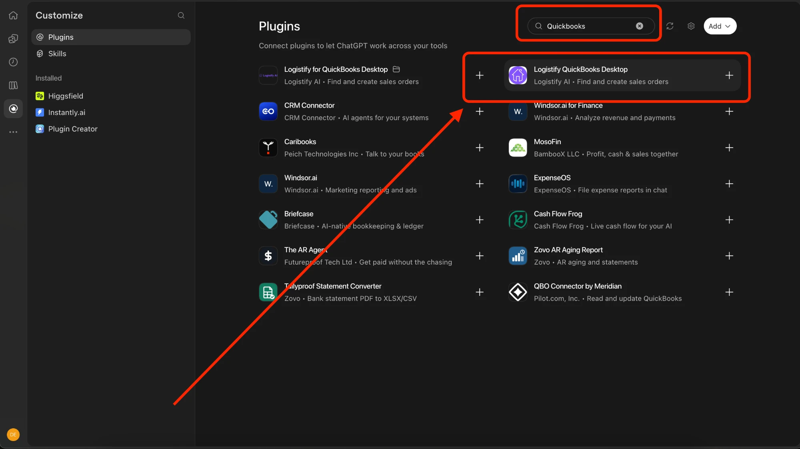
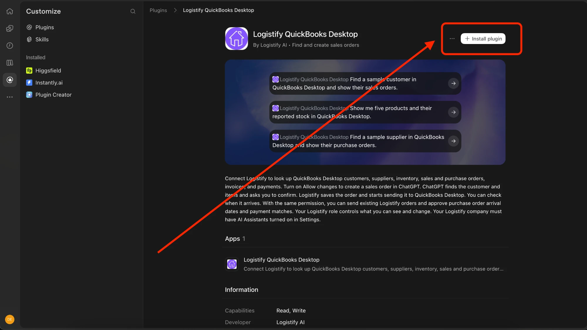

# Logistify QuickBooks Desktop: ChatGPT plugin for QuickBooks Desktop

**Logistify QuickBooks Desktop is a plugin for ChatGPT, Claude, Microsoft 365 Copilot, Gemini, Perplexity, Claude Code and Codex. It lets the assistant read customers, stock, sales and purchase orders, vendors, invoices and payments in a QuickBooks Desktop company file connected to Logistify and, with your permission, create sales orders and send them to QuickBooks. OpenAI approved it for ChatGPT's plugin directory on November 10, 2026.**

This repository holds documentation only: how to install and use the plugin. It's maintained by [Logistify AI](https://logistify.ai/?utm_source=github&utm_medium=offsite&utm_campaign=qbd-plugin-readme). Last checked November 13, 2026.



## Contents

- [Install it in ChatGPT](#install-it-in-chatgpt)
- [Add it by its MCP server address](#add-it-by-its-mcp-server-address)
- [What you need](#what-you-need)
- [What it can read and change](#what-it-can-read-and-change)
- [All 18 tools](#all-18-tools)
- [Questions to try](#questions-to-try)
- [Other assistants](#other-assistants)
- [Data, disconnecting and limits](#data-disconnecting-and-limits)
- [FAQ](#faq)

## Install it in ChatGPT

The plugin is listed in ChatGPT's plugin directory as **Logistify QuickBooks Desktop**, by Logistify AI. OpenAI's help says the directory is available on every ChatGPT plan, on web, desktop and mobile (checked November 13, 2026). Whether you can install a given plugin depends on your plan, workspace, role and region. In a Business or Enterprise workspace, an admin can choose which plugins members may install.

1. In ChatGPT, open **Plugins** in the side menu, or select **Plugins** under the message box.
2. In the **Search plugins** box, type `QuickBooks Desktop` and select **Logistify QuickBooks Desktop**, by Logistify AI.
3. Select **Install plugin**, then sign in with your Logistify login and choose your company.
4. On Logistify's connect page, tick **Allow changes** only if ChatGPT should be able to make the changes listed below. Left unticked, ChatGPT can read but can't change anything.









Video: [How to Connect ChatGPT to QuickBooks Desktop via ChatGPT Plugins](https://www.youtube.com/watch?v=9X5i31DXbfU).

## Add it by its MCP server address

A workspace admin can also add the plugin as a custom MCP server at:

```
https://mcp.logistify.ai/quickbooks-desktop/mcp
```

OpenAI's help says custom MCP servers are for ChatGPT Business and Enterprise/Edu workspaces on ChatGPT web, and that on Business only admins and owners can add and publish them (checked November 3, 2026).

1. In ChatGPT, open **Plugins**, select the plus button, then **Add custom MCP server**.
2. Name it `Logistify for QuickBooks Desktop`, enter the address above, and choose **OAuth** for authentication.
3. Accept the warning, select **Create as a plugin**, and review the tools ChatGPT finds.
4. An admin or owner publishes it for the workspace. Members then sign in with their Logistify login the first time they use it.

## What you need

- A Logistify account with your QuickBooks Desktop company file already connected to Logistify. Logistify works inside Desktop company files through the QuickBooks Web Connector, so nothing new is installed on the QuickBooks computer.
- A plan that includes the plugin: **Starter is $99 a month per company**, and the plugin is included at no extra cost in Logistify's Core, Business and Enterprise plans. There's no free trial.
- To get set up, [talk to Logistify](https://logistify.ai/get-started/?utm_source=github&utm_medium=offsite&utm_campaign=qbd-plugin-readme).

## What it can read and change

**It can read** customers, inventory items and stock, sales orders, vendors, purchase orders, invoices, payments received and deposit accounts in the company file, plus three of Logistify's own lists.

**It can make four changes**, the same ones Logistify's own screens make, and only these:

1. Create a new sales order from your chat request and send it to QuickBooks.
2. Send a sales order already saved in Logistify to QuickBooks.
3. Approve a purchase order date update (the expected date is set to the supplier's promised date; quantity and price never change).
4. Approve a customer payment match (Logistify then records the bank payment in QuickBooks against the matched invoices).

Changes happen only when the connection has **Allow changes** ticked, and before each one the assistant shows exactly what will change and waits for a clear yes, one item at a time. The change then goes through the same checks as Logistify's own screen. The assistant tells you the change has started and checks the result; it doesn't say it's done until the status shows it.

It can't change any other record: no invoices, bills, items, customers, quotes, purchase orders or stock, and no edits or deletes.

## All 18 tools

14 read and 4 make changes. The tool names are as ChatGPT and Claude show them.

| Tool | Reads or changes | What it reads or changes |
|---|---|---|
| Find QuickBooks customers | Reads | Customers, by part of the name or by exact QuickBooks ID |
| Find QuickBooks inventory items | Reads | Inventory items and their stock quantities |
| List QuickBooks sales orders | Reads | Sales orders for a customer, or by order number, with or without the lines |
| List Logistify sales orders and their QuickBooks status | Reads | Sales orders saved in Logistify, with each one's QuickBooks status |
| Create a sales order and send it to QuickBooks | **Changes** | A new sales order you ask for in chat: customer, products, quantities, any prices and the delivery date |
| Send a Logistify sales order to QuickBooks | **Changes** | An order saved in Logistify, sent to QuickBooks as a new sales order |
| Find QuickBooks vendors (suppliers) | Reads | Vendors, by part of the name |
| List QuickBooks purchase orders | Reads | A vendor's purchase orders, or ones by number, with received quantities and whether each is open |
| Show one QuickBooks purchase order | Reads | One purchase order with its lines and received quantities |
| List purchase order date updates waiting for approval | Reads | Suppliers' promised dates that are waiting for approval |
| Approve a purchase order date update | **Changes** | A QuickBooks purchase order's expected date, set to the supplier's promised date |
| List QuickBooks invoices | Reads | Invoices by customer, number or date, with what is still owed and the payments and credits applied |
| List payments received in QuickBooks | Reads | Customer payments by customer, reference number or date, with the invoices each one paid |
| List QuickBooks deposit accounts | Reads | The bank accounts and Undeposited Funds a payment can go to (names only) |
| List customer payments with a suggested invoice match | Reads | Customer payments and the invoices Logistify suggests each one pays |
| Approve a customer payment match | **Changes** | A suggested match, after which Logistify records the bank payment in QuickBooks |
| List QuickBooks company files | Reads | The company's QuickBooks files |
| Show the connected Logistify account | Reads | The Logistify account and company the connection uses |

Good to know:

- The three Logistify lists work even while QuickBooks is closed. Everything else is read live from the company file.
- For a new sales order, the customer and products must already be in Logistify and linked to QuickBooks. They're matched by exact ID or code, never a guess. A line with no price anywhere is refused, and a retry doesn't create a second order.
- Results come one page at a time: 25 records unless you ask for more, up to 150. A page isn't the full list or a company total.
- If QuickBooks doesn't answer, the assistant says so instead of showing older records.

## Questions to try

- Find our customer Acme in QuickBooks and show their open sales orders.
- Which of Acme's invoices from October are still unpaid, and how much is left on each?
- Create an order for Acme: 20 of item 4410B, delivered next Friday.
- Send order 1042 to QuickBooks.
- Which purchase order date updates are waiting for approval? Approve the one from Harbor Supply.
- Show customer payments with a suggested invoice match, and approve the match for Acme's payment.
- Show our open purchase orders with Harbor Supply and the lines that haven't been received yet.
- How many units of item 4410B do we have in stock?

(Customer and item names are examples.)

## Other assistants

The same plugin works in ChatGPT, Claude, Microsoft 365 Copilot (a package Logistify sends and your Microsoft 365 admin deploys), Gemini (the consumer Gemini app) and Perplexity, plus Claude Code and Codex. Each adds it differently. Setup pages:

- [ChatGPT](https://logistify.ai/plugins/quickbooks-desktop/chatgpt/?utm_source=github&utm_medium=offsite&utm_campaign=qbd-plugin-readme)
- [Claude](https://logistify.ai/plugins/quickbooks-desktop/claude/?utm_source=github&utm_medium=offsite&utm_campaign=qbd-plugin-readme)
- [Microsoft 365 Copilot](https://logistify.ai/plugins/quickbooks-desktop/microsoft-copilot/?utm_source=github&utm_medium=offsite&utm_campaign=qbd-plugin-readme)
- [Gemini](https://logistify.ai/plugins/quickbooks-desktop/gemini/?utm_source=github&utm_medium=offsite&utm_campaign=qbd-plugin-readme)
- [Perplexity](https://logistify.ai/plugins/quickbooks-desktop/perplexity/?utm_source=github&utm_medium=offsite&utm_campaign=qbd-plugin-readme)

The plugin is listed in ChatGPT's plugin directory. In the other assistants it isn't listed yet, so it's added as each setup page shows.

## Data, disconnecting and limits

- What the assistant reads is sent to its maker (OpenAI, Anthropic, Microsoft, Google or Perplexity). Results leave out addresses, emails, phones, notes, custom fields, tax details and bank details, and card details are never included. Each connection covers one company.
- To disconnect, open the company in Logistify and press **Disconnect** under Settings, then ChatGPT and Claude, then Connected assistants, or remove the plugin in ChatGPT's settings. Removal takes effect on the next request.
- What Logistify keeps, and for how long, is in the [privacy policy](https://logistify.ai/privacy/). See also the [terms](https://logistify.ai/terms/) and [support](https://logistify.ai/support/).

## FAQ

**Is there a ChatGPT plugin for QuickBooks Desktop?** Yes. Logistify QuickBooks Desktop is in ChatGPT's plugin directory: open Plugins in the side menu, search for QuickBooks Desktop and select Install plugin.

**Doesn't Intuit's own QuickBooks app in ChatGPT work with QuickBooks Desktop?** Intuit's QuickBooks apps in ChatGPT and Claude sign in to an account in Intuit's cloud: QuickBooks Online, and for Claude also Intuit Enterprise Suite. A Desktop company file lives on your own Windows computer or server, so those apps have nothing to read. This plugin connects through Logistify instead.

**Can it create a sales order in QuickBooks Desktop?** Yes, with Allow changes ticked and your yes. The assistant reads the whole order back first, then Logistify creates it and sends it to QuickBooks.

**Does it work with Claude?** Yes, as a custom connector. See the [Claude setup page](https://logistify.ai/plugins/quickbooks-desktop/claude/?utm_source=github&utm_medium=offsite&utm_campaign=qbd-plugin-readme).

## Related

- [Logistify for QuickBooks Desktop plugin page](https://logistify.ai/plugins/quickbooks-desktop/?utm_source=github&utm_medium=offsite&utm_campaign=qbd-plugin-readme)
- [Is there a QuickBooks Desktop MCP server?](https://logistify.ai/guides/quickbooks-desktop/quickbooks-desktop-mcp-server/?utm_source=github&utm_medium=offsite&utm_campaign=qbd-plugin-readme)
- [Logistify for Unleashed (ChatGPT plugin for Unleashed)](https://github.com/logistify-ai/logistify-unleashed-chatgpt-plugin)

---

ChatGPT and OpenAI are trademarks of OpenAI. QuickBooks is a trademark of Intuit Inc. Logistify AI is an independent company and isn't affiliated with or endorsed by OpenAI or Intuit; OpenAI reviewed and approved this plugin for its plugin directory.
